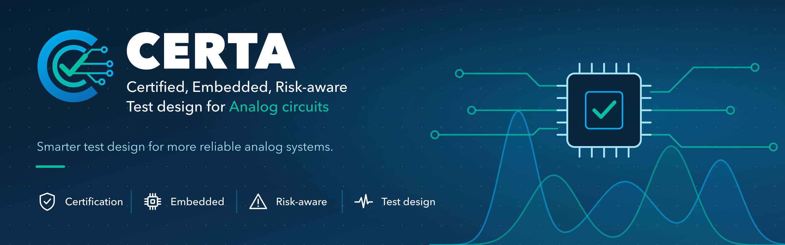
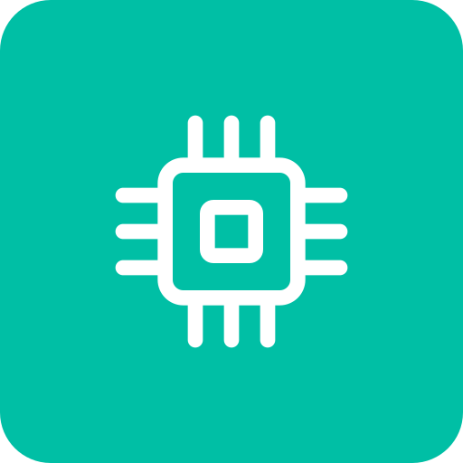

<p align="center">
  
</p>

<p align="center">
  
  
  
</p>

# CERTA

**Certified, Embedded, Risk-aware Test design for Analog circuits.** A research project on how to decide what an embedded system should measure in order to self-diagnose its analog electronics at board level.

## The problem

Analog test point selection has been studied for forty years and is now saturated with metaheuristics applied to the same benchmark filters. The gap is not in the optimiser but in the formulation: nobody brings together the five pieces that an in-field self-test needs.

| | Shortcoming in the literature | What CERTA proposes |
| :---: | --- | --- |
|  | Nodes, stimuli and measurements are optimised separately | Joint design of node, stimulus and measured feature |
|  | Cost is a count of nodes | A cost model of the embedded hardware: channels, switches, ADC noise and resolution |
|  | All fault classes weigh the same | Coverage weighted by fault probability and severity, with a bounded false alarm rate |
|  | Percentages without uncertainty, from 50 to 120 Monte Carlo runs | Coverage with confidence intervals and adaptive Monte Carlo |
|  | No theoretical bound and no reproducible comparison | Gap to the ambiguity groups and an open benchmark of reimplemented baselines |

The expected outcome is a `spicefault.testdesign` module that, starting from a netlist, returns the self-test plan (which channel, which stimulus, which thresholds) and its certified coverage, validated on boards and on biomedical front ends. The motivation, the formulation and the full plan are in [GUIDE.md](GUIDE.md).

<p align="center"></p>

## Work packages

| Package | What it does | Milestone | Status |
| --- | --- | --- | --- |
| [WP0 · State of the art](WP0-state-of-the-art/) | Systematic review in Scopus, IEEE Xplore and Web of Science | G0: the gap exists | In progress |
| [WP1 · Benchmark and certification](WP1-benchmark-and-certification/) | Reimplemented baselines, intervals and adaptive Monte Carlo | G1: the baselines reproduce the published figures | Pending |
| [WP2 · Formulation and algorithms](WP2-formulation-and-algorithms/) | Cost model, risk weighting, greedy, exact ILP and theoretical bound | G2: the greedy stays close to the optimum and risk changes the selection | Pending |
| [WP3 · Board validation](WP3-board-validation/) | Two boards with fault injection and self-test firmware | G3: the simulated ranking holds on the board | Pending |
| [WP4 · Biomedical application](WP4-biomedical-application/) | ECG front end and Howland source with severities according to IEC 60601 | — | Pending |

The tasks of each package and their estimated duration are in [ROADMAP.md](ROADMAP.md).

## Repository structure

| Path | Contents |
| --- | --- |
| `WPn-…/` | One work package per folder, with its own `README.md` and one subfolder per task (`T0.1-protocol`…) |
| [GUIDE.md](GUIDE.md) | Starting document: state of the art, gap, formulation, experiments and planned publications |
| [ROADMAP.md](ROADMAP.md) | Tasks, deliverables and estimated duration |
| [CONTRIBUTING.md](CONTRIBUTING.md) | How to work in the repository: notebooks, data, documents and commits |
| [docs/assets/](docs/assets/) | Visual identity |
| [web/](web/) | Project website, built with Quarto. Preview with `quarto preview web` |

## Getting started

Python 3.11 or later is required.

```bash
git clone https://github.com/telmomm/CERTA.git
cd CERTA
python3 -m venv .venv
source .venv/bin/activate
pip install -r requirements.txt
```

Analyses are Jupyter notebooks inside the folder of each task and are committed executed. To re-run one, from its folder:

```bash
jupyter nbconvert --to notebook --execute --inplace 01_screening.ipynb
```

## Visual identity

The reference is [visual-identity.png](docs/assets/visual-identity.png). The PNGs in [docs/assets/](docs/assets/) are generated with `python3 docs/assets/generate.py` (requires `rsvg-convert` and the Avenir Next font); to change an asset, edit the script, not the PNG.

| Folder | Assets |
| --- | --- |
| `logo/` | Logo and logo mark for light and dark (`-dark`) backgrounds, with transparency, and `certa-favicon.png` |
| `banners/` | GitHub header (2560×800), social preview (1280×640) and square for announcements (1080×1080) |
| `icons/` | Certification, embedded, risk and test: navy line, white line (`-white`) and on a coloured box (`-box`) |
| `backgrounds/` | Dark and light slide backgrounds (1920×1080) and divider |

| | | | | |
| :---: | :---: | :---: | :---: | :---: |
|  |  |  |  |  |
| Navy | Teal | Blue | Sky | Ice |
